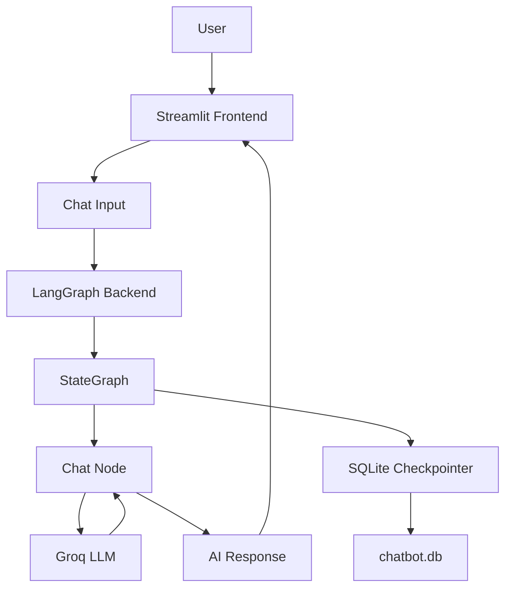
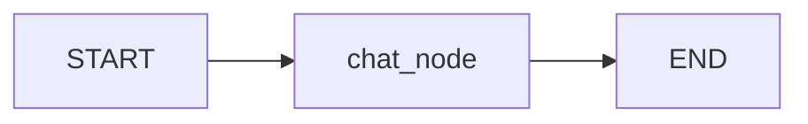

# LangGraph Chatbot

A conversational AI chatbot built using **LangGraph, Groq, Streamlit, and SQLite**. This project explores how to build a stateful chatbot capable of maintaining multiple conversations, persisting chat history, and streaming responses in real time.

This is a learning project developed while exploring LangGraph, conversational state management, checkpointing, streaming, and the integration of a backend with a Streamlit frontend.

---

## Overview

Traditional chatbot implementations often maintain conversation history manually and send the entire history to the language model with every request. This project explores how LangGraph can simplify conversation management by introducing a structured state-based workflow and persistent checkpointing.

The chatbot allows users to:

- Interact with an LLM through a Streamlit-based chat interface.
- Create multiple independent conversations.
- Switch between previously created conversations.
- Maintain conversation context across messages.
- Persist conversation states using SQLite.
- Stream AI responses token by token.
- Manage conversation threads using unique thread IDs.

The primary objective of this project was to understand the fundamentals of building stateful AI applications using LangGraph rather than simply creating a basic LLM wrapper.

---

## Tech Stack

| Technology | Purpose |
|---|---|
| Python | Core programming language |
| LangGraph | Building and managing the chatbot workflow |
| LangChain | Message abstractions and LLM integration |
| Groq | LLM inference |
| OpenAI GPT-OSS 120B | Language model used for generating responses |
| Streamlit | Frontend and interactive chat interface |
| SQLite | Persistent storage for conversation checkpoints |
| LangGraph SQLite Checkpointer | Saving and restoring conversation states |
| python-dotenv | Loading environment variables |
| UUID | Generating unique conversation thread IDs |

---

## Architecture

The application follows a simple backend-frontend architecture.



### Frontend

The frontend is built using Streamlit and is responsible for:

- Displaying the chat interface.
- Accepting user messages.
- Rendering user and assistant messages.
- Streaming AI responses.
- Managing the active conversation thread.
- Providing a sidebar for creating and switching between conversations.

### Backend

The backend is implemented using LangGraph and is responsible for:

- Defining the chatbot's state.
- Processing messages through a graph workflow.
- Invoking the language model.
- Updating conversation state.
- Persisting conversation checkpoints.

### Database

SQLite is used with LangGraph's `SqliteSaver` to persist conversation checkpoints.

This allows the chatbot to retrieve the state associated with a particular conversation thread instead of treating every interaction as an independent request.

---

## Project Structure

```text
LangGraph-Chatbot/
│
├── langgraph_database_backend.py
├── streaming_frontend_threading.py
├── requirements.txt
├── .env
├── .env.example
├── .gitignore
│
└── chatbot.db
```

> `chatbot.db` is generated locally when the backend initializes the SQLite database. It is not required to be committed to the repository.

The actual project may contain additional files depending on development and experimentation.

---

## How It Works

### 1. Defining the Chat State

The chatbot uses a TypedDict to define its state.

```python
class ChatState(TypedDict):
    message: Annotated[list[BaseMessage], add_messages]
```

The state contains a list of messages.

The `add_messages` reducer is used to manage message updates. Instead of simply replacing the existing messages, it allows new messages to be incorporated into the conversation state.

This is one of the important concepts explored in LangGraph: **state is passed between nodes and updated as the graph executes.**

---

### 2. Creating the Chat Node

The chatbot contains a node called `chat_node`.

```python
def chat_node(state: ChatState):
    message = state['message']
    response = model.invoke(message)
    return {'message': [response]}
```

The node receives the current state, extracts the messages, sends them to the language model, and returns the generated response.

The response is then added to the graph's state.

---

### 3. Building the LangGraph Workflow

The graph is created using `StateGraph`.

```python
graph = StateGraph(ChatState)

graph.add_node("chat_node", chat_node)

graph.add_edge(START, "chat_node")
graph.add_edge("chat_node", END)

chatbot = graph.compile(checkpointer=checkpointer)
```

The current workflow is intentionally simple:



The graph starts execution, passes the state to the `chat_node`, generates a response, and terminates.

Although the current graph contains only one node, this structure provides a foundation for extending the chatbot with additional nodes such as tools, retrieval systems, memory processing, and conditional workflows.

---

### 4. Integrating Groq

The project uses Groq for LLM inference.

```python
model = ChatGroq(
    model="openai/gpt-oss-120b",
    temperature=0.7
)
```

The model is invoked inside the chatbot node using:

```python
response = model.invoke(message)
```

Groq provides the inference infrastructure, while LangChain provides the interface used to interact with the model.

The temperature parameter controls the degree of randomness in the generated responses.

---

### 5. Conversation Persistence Using SQLite

One of the main features explored in this project is persistent conversation state.

```python
conn = sqlite3.connect(
    database="chatbot.db",
    check_same_thread=False
)

checkpointer = SqliteSaver(conn=conn)
```

The SQLite connection is used by LangGraph's `SqliteSaver` to save graph checkpoints.

The graph is compiled with the checkpointer:

```python
chatbot = graph.compile(
    checkpointer=checkpointer
)
```

This allows LangGraph to save and retrieve the state of a conversation associated with a particular thread ID.

Instead of manually storing every message in a separate database structure, the checkpointer handles the persistence of the graph state.

---

### 6. Thread-Based Conversations

Each conversation is assigned a unique thread ID using UUID.

```python
def generate_thread_id():
    thread_id = uuid.uuid4()
    return thread_id
```

A thread ID is passed through the graph configuration:

```python
CONFIG = {
    'configurable': {
        'thread_id': st.session_state['thread_id']
    }
}
```

This allows LangGraph to identify which conversation state should be loaded and updated.

When a user starts a new conversation, a new thread ID is generated. When an existing conversation is selected, its corresponding thread ID is used to retrieve the saved state.

This enables multiple independent conversations to exist within the same chatbot application.

---

### 7. Streamlit Session State

Streamlit reruns the application script whenever the user interacts with the interface.

To prevent the active chat from being reset during these reruns, the project uses `st.session_state`.

The application maintains the following information:

- `thread_id` — The ID of the currently active conversation.
- `message_history` — Messages currently displayed in the chat interface.
- `chat_threads` — A list of conversation thread IDs maintained by the frontend.

These variables allow the application to preserve the active conversation and manage the frontend state across Streamlit reruns.

---

### 8. Creating a New Chat

The New Chat button calls the `reset_chat()` function.

```python
def reset_chat():
    thread_id = generate_thread_id()
    st.session_state['thread_id'] = thread_id
    add_thread(st.session_state['thread_id'])
    st.session_state['message_history'] = []
```

This function:

1. Generates a new unique thread ID.
2. Sets it as the active conversation.
3. Adds it to the conversation list.
4. Clears the currently displayed message history.

The new conversation starts with an empty frontend message history and a new thread identifier.

---

### 9. Switching Between Conversations

The sidebar displays conversation thread IDs.

When a conversation is selected, the frontend retrieves its saved state using:

```python
def load_conversation(thread_id):
    return chatbot.get_state(
        config={
            'configurable': {
                'thread_id': thread_id
            }
        }
    ).values['message']
```

The retrieved messages are then converted into a format suitable for displaying in the Streamlit chat interface.

This allows users to switch between different conversations without losing the context associated with each thread.

---

### 10. Streaming Responses

The chatbot uses LangGraph's streaming functionality to generate responses incrementally.

```python
ai_message = st.write_stream(
    message_chunk.content
    for message_chunk, metadata in chatbot.stream(
        {'message': [HumanMessage(content=user_input)]},
        config=CONFIG,
        stream_mode='messages'
    )
)
```

Instead of waiting for the complete response, the frontend displays content as it becomes available.

This provides a more interactive experience and helps reduce the perceived waiting time during LLM inference.

The streamed message chunks are rendered using Streamlit's `st.write_stream()`.

---

## Running the Project Locally

### Prerequisites

- Python 3.10 or later
- Git
- A Groq API key
- Basic familiarity with Python and command-line tools

### 1. Clone the Repository

```bash
git clone https://github.com/krishna-pov/LangGraph-Chatbot.git
```

Navigate into the project directory:

```bash
cd LangGraph-Chatbot
```

### 2. Create a Virtual Environment

```bash
python -m venv venv
```

Activate the environment.

**Windows:**

```powershell
venv\Scripts\activate
```

**Linux/macOS:**

```bash
source venv/bin/activate
```

### 3. Install Dependencies

```bash
pip install -r requirements.txt
```

### 4. Configure Environment Variables

Create a `.env` file in the root directory.

```env
GROQ_API_KEY=your_groq_api_key
```

Obtain your API key from the Groq developer platform.

The `.env` file should never be committed to GitHub.

The repository includes a `.env.example` file to demonstrate the required environment variables.

### 5. Run the Application

```bash
streamlit run streaming_frontend_threading.py
```

Streamlit will start the application and provide a local URL, usually:

```text
http://localhost:8501
```

Open this URL in your browser to interact with the chatbot.

---

## Features Implemented

- Conversational interaction with an LLM.
- LangGraph-based chatbot workflow.
- Stateful message management.
- Multiple conversation threads.
- Unique thread IDs using UUID.
- SQLite-based checkpoint persistence.
- Conversation state retrieval.
- Streamlit chat interface.
- Sidebar-based conversation navigation.
- New Chat functionality.
- Streaming AI responses.
- Environment variable-based API key management.

---

## Learning Objectives

This project was developed to explore and understand the following concepts:

### LangGraph

- Creating a `StateGraph`.
- Defining graph state using `TypedDict`.
- Using nodes and edges.
- Understanding `START` and `END`.
- Compiling a graph.
- Passing state between nodes.
- Using reducers such as `add_messages`.

### Stateful AI Applications

- Maintaining conversation context.
- Managing independent conversation threads.
- Passing thread IDs through graph configuration.
- Retrieving previous conversation states.

### Checkpointing and Persistence

- Understanding LangGraph checkpointing.
- Using SQLite as a persistence layer.
- Saving graph states.
- Retrieving conversation history from checkpoints.

### Streamlit

- Managing application state using `st.session_state`.
- Building chat interfaces using `st.chat_message`.
- Accepting input using `st.chat_input`.
- Creating sidebar navigation.
- Streaming output using `st.write_stream`.
- Understanding Streamlit's rerun behavior.

### LLM Integration

- Integrating Groq with LangChain.
- Invoking an LLM through a chatbot node.
- Streaming model responses.
- Managing API keys through environment variables.

---

## Current Limitations

This project is a learning implementation and is not intended to be a production-ready chatbot.

Some limitations and areas for improvement include:

- The graph currently consists of a single chatbot node.
- There is no tool calling or agentic workflow implemented.
- There is no retrieval-augmented generation (RAG).
- There is no authentication or user management.
- Conversation thread IDs are displayed directly in the sidebar.
- The frontend conversation list is maintained using Streamlit session state rather than being fully reconstructed from the database.
- There is no dedicated conversation deletion functionality.
- There is no custom error handling for API failures or rate limits.
- The application does not include a dedicated database management layer.
- The interface is minimal and focused primarily on functionality.
- The application has not been optimized for multi-user deployment.

---

## Future Improvements

Possible improvements that I would like to explore as I continue learning include:

- Implementing proper conversation history retrieval from the database.
- Improving conversation naming and sidebar organization.
- Adding conversation deletion and management.
- Implementing tool calling using LangGraph.
- Exploring conditional edges and more complex graph workflows.
- Adding RAG capabilities using vector databases.
- Implementing long-term memory.
- Improving error handling and API failure recovery.
- Adding user authentication.
- Improving the UI/UX.
- Exploring deployment options.
- Adding support for different LLM providers.

---

## What I Learned

Building this project helped me move beyond basic LLM API calls and understand how conversational AI applications can be structured using a graph-based workflow.

Some of the most important concepts I explored were:

- How LangGraph manages application state.
- How graph nodes process and update state.
- How conversation threads can be maintained independently.
- How checkpointing enables persistence.
- How SQLite can be integrated with LangGraph.
- How Streamlit session state works.
- How to stream responses from an LLM.
- How the frontend and backend interact in a conversational application.

This project represents an ongoing learning process, and I intend to build upon this implementation as I explore more advanced concepts in LangGraph and AI application development.

---

## Acknowledgements

This project was built as part of my learning journey into LangGraph, LangChain, and the development of stateful AI applications.

The implementation is based on experimentation, learning, and gradually understanding how different components of an LLM-powered chatbot work together.
